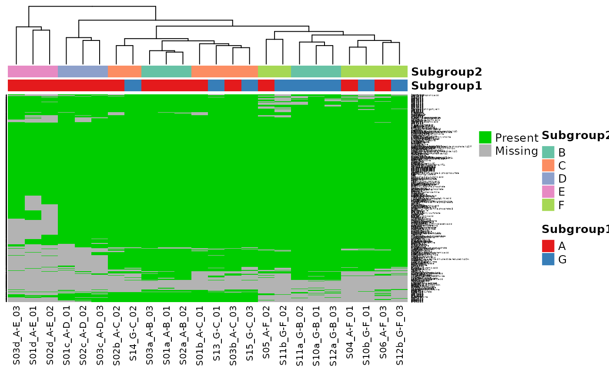
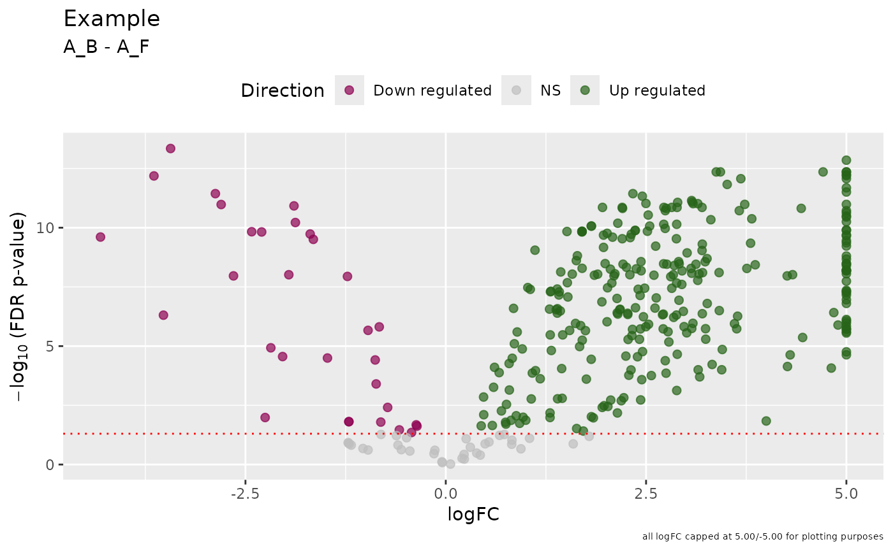

# damR

## Usage

``` r

library(damR)
exdata_path <- list.files(
  system.file(package = "damR", "extdata"),
  "example_data.csv",
  full.names = TRUE
)
```

## Load and clean data

[`ReadFile()`](https://vari-bbc.github.io/damR/reference/ReadFile.md)
expects a wide-format dataset where the rows are samples and columns are
metabolites.

``` r

read.csv(exdata_path)[1:10, 1:5]
#>         Sample Histidine_IP Glycine_IP Serine_IP Asparagine_IP
#> 1  S01a_A-B_01     45579054   76592811  38007391       4580929
#> 2  S01b_A-C_01     13072561   24625238  17531599       1551767
#> 3  S01c_A-D_01      4312298    7852034   6420602        289036
#> 4  S01d_A-E_01      1928348    1652953        NA         68157
#> 5  S02a_A-B_02     43441954   70070730  32944539       4117218
#> 6  S02b_A-C_02     14035246   26371310  16108976       1569177
#> 7  S02c_A-D_02      4481968    9056500   6310596        426139
#> 8  S02d_A-E_02      2350293    2699275   2089174        145032
#> 9  S03a_A-B_03     45869650   79937601  37503859       4729428
#> 10 S03b_A-C_03     14058030   25090665  16919752       1527971
```

The `Sample` column should be in the form
`SampleID_Subgroup1ID-Subgroup2ID_BatchNo` to infer Sample, Group,
Subgroup, and Batch identifiers based on the “\_” and “-” delimiters.
The Metabolite column must be in the form
`MetaboliteName_ExtractionMethod` for filtering based on extraction
method (IP/HILIC/T3Acidic).

``` r

(mdata <- ReadFile(exdata_path))
#> Found batches: 1, 2, 3, 4, 5, 6
#>              Sample SampleID   Group Subgroup1 Subgroup2  Batch    Metabolite
#>              <char>   <char>  <char>    <char>    <char> <fctr>        <char>
#>     1:  S01a_A-B_01     S01a     A_B         A         B      1     Histidine
#>     2:  S01b_A-C_01     S01b     A_C         A         C      1     Histidine
#>     3:  S01c_A-D_01     S01c     A_D         A         D      1     Histidine
#>     4:  S01d_A-E_01     S01d     A_E         A         E      1     Histidine
#>     5:  S02a_A-B_02     S02a     A_B         A         B      2     Histidine
#>    ---                                                                       
#> 16096: TC_QC-pool_2       TC QC_pool        QC      pool      2 D.Sphingosine
#> 16097: TC_QC-pool_3       TC QC_pool        QC      pool      3 D.Sphingosine
#> 16098: TC_QC-pool_4       TC QC_pool        QC      pool      4 D.Sphingosine
#> 16099: TC_QC-pool_5       TC QC_pool        QC      pool      5 D.Sphingosine
#> 16100: TC_QC-pool_6       TC QC_pool        QC      pool      6 D.Sphingosine
#>            Type    value
#>          <char>    <num>
#>     1:       IP 25.44187
#>     2:       IP 23.64004
#>     3:       IP 22.04003
#>     4:       IP 20.87893
#>     5:       IP 25.37259
#>    ---                  
#> 16096: T3Acidic 21.97819
#> 16097: T3Acidic 21.90662
#> 16098: T3Acidic 18.20672
#> 16099: T3Acidic 18.24809
#> 16100: T3Acidic 18.42540
```

[`ReadFile()`](https://vari-bbc.github.io/damR/reference/ReadFile.md)
pivots the data from wide to long or tidy form for the rest of the
analysis.

## QC

Each metabolite in the dataset may be sampled with multiple extraction
methods. For each metabolite,
[`FilterExtraction()`](https://vari-bbc.github.io/damR/reference/FilterExtraction.md)
selects the method with the fewest NAs or the lowest variation.
[`FilterBlanks()`](https://vari-bbc.github.io/damR/reference/FilterBlanks.md)
runs blank filtering to remove metabolites from non-blank samples that
fail to meet a specified fold-change threshold compared to the same
metabolites from blank samples. To identify the data that get blank
filtered without running the filtering, use
[`GetBlankDropTable()`](https://vari-bbc.github.io/damR/reference/GetBlankDropTable.md)
which
[`FilterBlanks()`](https://vari-bbc.github.io/damR/reference/FilterBlanks.md)
uses to identify the metabolites to remove as well as the blank samples.

`QCData` is a top-level function that calls both
[`FilterExtraction()`](https://vari-bbc.github.io/damR/reference/FilterExtraction.md)
and
[`FilterBlanks()`](https://vari-bbc.github.io/damR/reference/FilterBlanks.md),
and removes metabolites with low variance.

``` r

to_drop <- GetBlankDropTable(mdata)
head(to_drop$dropTable)
#>     Batch       Sample SampleID   Group Subgroup1 Subgroup2   Metabolite   Type
#>    <fctr>       <char>   <char>  <char>    <char>    <char>       <char> <char>
#> 1:      1  S01d_A-E_01     S01d     A_E         A         E      Glycine     IP
#> 2:      1  S01d_A-E_01     S01d     A_E         A         E   Citrulline     IP
#> 3:      1  S01d_A-E_01     S01d     A_E         A         E       Valine     IP
#> 4:      1  S10a_G-B_01     S10a     G_B         G         B       Uracil     IP
#> 5:      1 TC_QC-pool_1       TC QC_pool        QC      pool Hypoxanthine     IP
#> 6:      1 TC_QC-pool_1       TC QC_pool        QC      pool     Xanthine     IP
#>        value max_blank       diff
#>        <num>     <num>      <num>
#> 1: 20.656614 18.790587  1.8660271
#> 2: 16.949827 14.776382  2.1734451
#> 3: 19.927279 17.785746  2.1415326
#> 4: 20.058855 18.149444  1.9094100
#> 5:  1.584963  1.000000  0.5849625
#> 6:  1.000000  2.321928 -1.3219281
to_drop$blanks
#> [1] "TC_Blank-process_1" "TC_Blank-process_2" "TC_Blank-process_3"
#> [4] "TC_Blank-process_4" "TC_Blank-process_5"

qc_data <- QCData(mdata)
```

[`RemoveMissing()`](https://vari-bbc.github.io/damR/reference/RemoveMissing.md)
drops metabolites with more NAs than a specified proportion. To identify
those that would be removed without removing them, call
[`IdentifyMissing()`](https://vari-bbc.github.io/damR/reference/IdentifyMissing.md).
Run
[`PlotMissingness()`](https://vari-bbc.github.io/damR/reference/PlotMissingness.md)
to get a presence/absence heatmap of your data.

``` r

PlotMissingness(qc_data)
#> Warning in RColorBrewer::brewer.pal(counts, anno.pal[x]): minimal value for n is 3, returning requested palette with 3 different levels
```



``` r

head(IdentifyMissing(qc_data))
#> [1] "AcCa.14.0." "AcCa.14.1." "AcCa.15.2." "AcCa.16.0." "AcCa.16.2."
#> [6] "AcCa.18.0."
rm_data <- RemoveMissing(qc_data)
```

To examine your data before and after QC, you can use PCA. By default it
returns a `ggplot` object but if `ggiraph` is available, setting
`interactive = TRUE` and using
[`ggiraph::girafe()`](https://davidgohel.github.io/ggiraph/reference/girafe.html)
to render the plot will produce an interactive plot.

``` r

library(ggplot2)
library(patchwork)
ggiraph_available <- requireNamespace("ggiraph", quietly = TRUE)

pca.raw <- PlotPCA(GetPCA(mdata), interactive = ggiraph_available) + ggtitle("Raw")
pca.qc <- PlotPCA(GetPCA(qc_data), interactive = ggiraph_available) + ggtitle("QC")
pca.rm <- PlotPCA(GetPCA(rm_data), interactive = ggiraph_available) +
  ggtitle("Missingness removed")

pcas <- list(pca.raw, pca.qc, pca.rm) |> wrap_plots(nrow = 3, guides = "collect")

if (ggiraph_available) ggiraph::girafe(pcas) else pcas
```

## Imputation

``` r

imputed_data <- impute.QRILC(rm_data)
```

## Model fitting

[`DiffMetabolites()`](https://vari-bbc.github.io/damR/reference/DiffMetabolites.md)
uses `limma` to compute differential abundance of metabolites on
specified groups. If unspecified, all unique Group identifiers are
compared. By default, it produce contrasts in both directions for to
make comparisons easy to view and plot: with groups A, B, and C the
contrasts are A - B, A - C, and B - C as well as B - A, C - A, and C -
B. Set `reverseContrasts = FALSE` if you want just one direction.

``` r

groups <- unique(imputed_data$Group)

results <- DiffMetabolites(imputed_data)

PlotVolcano(results, groups[c(1, 5)], contrastTitle = "Example", cap = 5)
```



As with the PCA plots, setting `interactive = TRUE` produces interactive
volcano plots. With
[`PlotAllVolcanoes()`](https://vari-bbc.github.io/damR/reference/PlotAllVolcanoes.md)
you can plot multiple groups, returned as a lit of plots. Here we
collect the captions that show up when the fold-changes are capped and
the common main title into a single title and caption.

``` r

all_volcanoes.list <- PlotAllVolcanoes(
  results,
  groups[c(1:3)],
  cap = 10,
  contrastTitle = "Example",
  interactive = ggiraph_available
)

# extract the caption to 'collect' it
caption <- all_volcanoes.list[[1]]@labels$caption
title <- all_volcanoes.list[[1]]@labels$title

# drop the titles and captions
all_volcanoes <- lapply(all_volcanoes.list, \(p) p + labs(title = NULL, caption = NULL)) |>
  wrap_plots(guides = "collect") &
  theme_minimal(7) &
  theme(legend.position = "top") &
  plot_annotation(title = title, caption = caption)

if (ggiraph_available) ggiraph::girafe(all_volcanoes) else all_volcanoes
```

## Pipeline

``` r

fc_data <- ReadFile(exdata_path) |>
  QCData() |>
  RemoveMissing() |>
  impute.QRILC() |>
  DiffMetabolites()
```
