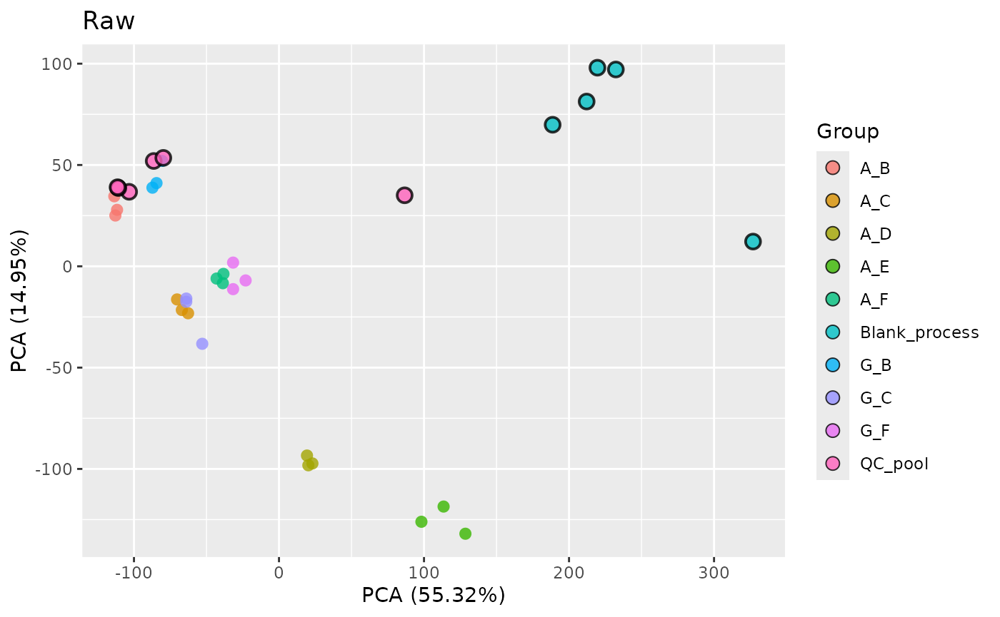
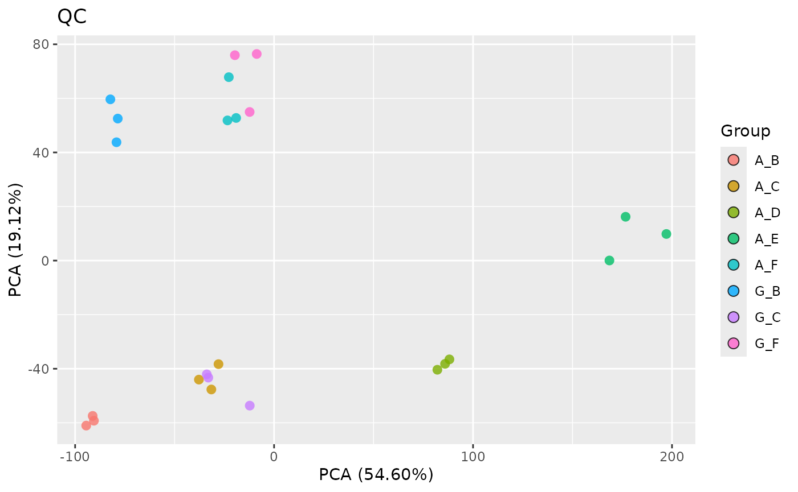
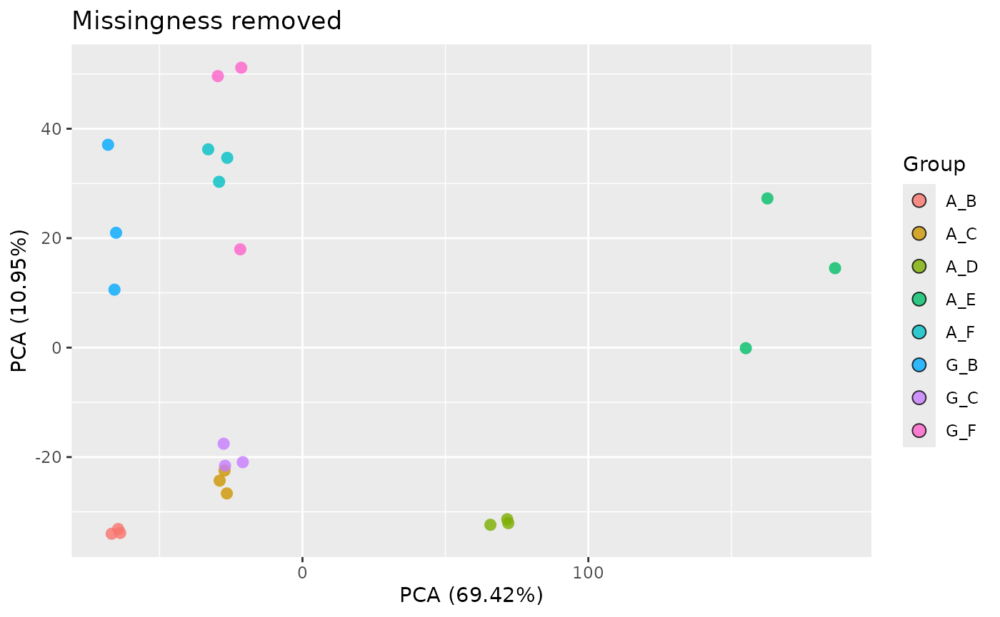
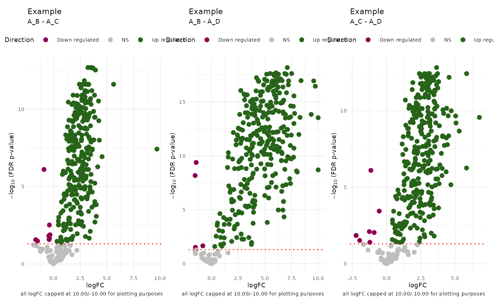

# damR

## Usage

``` r

library(damR)
exdata_path <- list.files(
  system.file(package = "damR", "extdata"),
  "example_data.csv",
  full.names = TRUE
)
```

## Load and clean data

[`ReadFile()`](https://vari-bbc.github.io/damR/reference/ReadFile.md)
expects a wide-format dataset where the rows are samples and columns are
metabolites.

``` r

read.csv(exdata_path)[1:10, 1:5]
#>         Sample Histidine_IP Glycine_IP Serine_IP Asparagine_IP
#> 1  S01a_A-B_01     45579054   76592811  38007391       4580929
#> 2  S01b_A-C_01     13072561   24625238  17531599       1551767
#> 3  S01c_A-D_01      4312298    7852034   6420602        289036
#> 4  S01d_A-E_01      1928348    1652953        NA         68157
#> 5  S02a_A-B_02     43441954   70070730  32944539       4117218
#> 6  S02b_A-C_02     14035246   26371310  16108976       1569177
#> 7  S02c_A-D_02      4481968    9056500   6310596        426139
#> 8  S02d_A-E_02      2350293    2699275   2089174        145032
#> 9  S03a_A-B_03     45869650   79937601  37503859       4729428
#> 10 S03b_A-C_03     14058030   25090665  16919752       1527971
```

The `Sample` column should be in the form
`SampleID_Subgroup1ID-Subgroup2ID_BatchNo` to infer Sample, Group,
Subgroup, and Batch identifiers based on the “\_” and “-” delimiters.
The Metabolite column must be in the form
`MetaboliteName_ExtractionMethod` for filtering based on extraction
method (IP/HILIC/T3Acidic).

``` r

(mdata <- ReadFile(exdata_path))
#>              Sample SampleID   Group Subgroup1 Subgroup2  Batch    Metabolite
#>              <char>   <char>  <char>    <char>    <char> <char>        <char>
#>     1:  S01a_A-B_01     S01a     A_B         A         B     01     Histidine
#>     2:  S01b_A-C_01     S01b     A_C         A         C     01     Histidine
#>     3:  S01c_A-D_01     S01c     A_D         A         D     01     Histidine
#>     4:  S01d_A-E_01     S01d     A_E         A         E     01     Histidine
#>     5:  S02a_A-B_02     S02a     A_B         A         B     02     Histidine
#>    ---                                                                       
#> 16096: TC_QC-pool_2       TC QC_pool        QC      pool      2 D-Sphingosine
#> 16097: TC_QC-pool_3       TC QC_pool        QC      pool      3 D-Sphingosine
#> 16098: TC_QC-pool_4       TC QC_pool        QC      pool      4 D-Sphingosine
#> 16099: TC_QC-pool_5       TC QC_pool        QC      pool      5 D-Sphingosine
#> 16100: TC_QC-pool_6       TC QC_pool        QC      pool      6 D-Sphingosine
#>            Type    value
#>          <char>    <num>
#>     1:       IP 25.44187
#>     2:       IP 23.64004
#>     3:       IP 22.04003
#>     4:       IP 20.87893
#>     5:       IP 25.37259
#>    ---                  
#> 16096: T3Acidic 21.97819
#> 16097: T3Acidic 21.90662
#> 16098: T3Acidic 18.20672
#> 16099: T3Acidic 18.24809
#> 16100: T3Acidic 18.42540
```

[`ReadFile()`](https://vari-bbc.github.io/damR/reference/ReadFile.md)
pivots the data from wide to long or tidy form for the rest of the
analysis.

## QC

Each metabolite in the dataset may be sampled with multiple extraction
methods. For each metabolite,
[`FilterExtraction()`](https://vari-bbc.github.io/damR/reference/FilterExtraction.md)
selects the method with the fewest NAs or the lowest variation.
[`FilterBlanks()`](https://vari-bbc.github.io/damR/reference/FilterBlanks.md)
runs blank filtering to remove metabolites from non-blank samples that
fail to meet a specified fold-change threshold compared to the same
metabolites from blank samples. To identify the data that get blank
filtered without running the filtering, use
[`GetBlankDropTable()`](https://vari-bbc.github.io/damR/reference/GetBlankDropTable.md)
which
[`FilterBlanks()`](https://vari-bbc.github.io/damR/reference/FilterBlanks.md)
uses to identify the metabolites to remove as well as the blank samples.

`QCData` is a top-level function that calls both
[`FilterExtraction()`](https://vari-bbc.github.io/damR/reference/FilterExtraction.md)
and
[`FilterBlanks()`](https://vari-bbc.github.io/damR/reference/FilterBlanks.md),
and removes metabolites with low variance.

``` r

to_drop <- GetBlankDropTable(mdata)
head(to_drop$dropTable)
#>     Batch       Sample SampleID   Group Subgroup1 Subgroup2    Metabolite
#>    <char>       <char>   <char>  <char>    <char>    <char>        <char>
#> 1:      1 TC_QC-pool_1       TC QC_pool        QC      pool  Hypoxanthine
#> 2:      1 TC_QC-pool_1       TC QC_pool        QC      pool      Xanthine
#> 3:      1 TC_QC-pool_1       TC QC_pool        QC      pool  Deoxyuridine
#> 4:      1 TC_QC-pool_1       TC QC_pool        QC      pool       Adenine
#> 5:      1 TC_QC-pool_1       TC QC_pool        QC      pool Phenylalanine
#> 6:      1 TC_QC-pool_1       TC QC_pool        QC      pool     Thymidine
#>      Type     value max_blank       diff
#>    <char>     <num>     <num>      <num>
#> 1:     IP  1.584963  1.000000  0.5849625
#> 2:     IP  1.000000  2.321928 -1.3219281
#> 3:     IP 11.315150  9.733015  1.5821342
#> 4:     IP 21.131802 18.927622  2.2041806
#> 5:     IP 18.291094 18.074695  0.2163987
#> 6:     IP  2.000000  1.000000  1.0000000
to_drop$blanks
#> [1] "TC_Blank-process_1" "TC_Blank-process_2" "TC_Blank-process_3"
#> [4] "TC_Blank-process_4" "TC_Blank-process_5"

qc_data <- QCData(mdata)
```

[`RemoveMissing()`](https://vari-bbc.github.io/damR/reference/RemoveMissing.md)
drops metabolites with more NAs than a specified proportion. To just get
those that would be removed, use `IdentifyMetabolites()`. Use
`PlotMissingness` to get a presence/absence heatmap of your data.

``` r

head(IdentifyMissing(qc_data))
#> [1] "2'-Deoxycytidine"           "2-Hydroxybutyrate"         
#> [3] "2-Methylcitrate"            "3-Hydroxyisobutyrate"      
#> [5] "3-Methyl-2-oxovaleric acid" "4-Hydroxybutyrate"
rm_data <- RemoveMissing(qc_data)
```

To examine your data before and after QC, you can use PCA:

``` r

library(patchwork)
library(ggplot2)
PlotPCA(GetPCA(mdata)) + ggtitle("Raw")
```



``` r

PlotPCA(GetPCA(qc_data))+ ggtitle("QC")
```



``` r

PlotPCA(GetPCA(rm_data))+ ggtitle("Missingness removed")
```



## Imputation

``` r

imputed_data <- impute.QRILC(rm_data)
```

## Model fitting

``` r

groups <- unique(imputed_data$Group)

results <- DiffMetabolites(imputed_data)

PlotVolcano(results, groups[c(1, 5)], contrastTitle = "Example")
```


``` r

PlotAllVolcanoes(results, groups[c(1:3)], contrastTitle = "Example") |>
  wrap_plots()
```



## Pipeline

``` r

fc_data <- ReadFile(exdata_path) |>
  QCData() |>
  RemoveMissing() |>
  impute.QRILC() |>
  DiffMetabolites()
```
